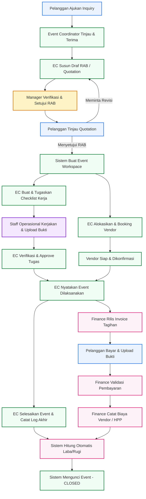

# 🚀 Sistem Manajemen Event Organizer (EO)
*(Versi Update — Tersinkronisasi dengan Use Case & Activity Diagram Final)*

Platform enterprise terintegrasi yang dirancang khusus untuk mengelola operasional Event Organizer (EO) secara profesional, efisien, dan bebas dari kendala komunikasi rill di lapangan.

---

### 📂 Dokumen Arsip Emas Perancangan (Golden Archives)
Sebelum diimplementasikan ke dalam kode, rancangan sistem ini telah dianalisis secara mendalam untuk menjamin konsistensi logika:
* 📊 **[Usecase & Activity Diagram Final](docs/usecase_dan_activity_diagram.md)** — Berisi detail 28 use case dan pemetaan diagram alur aktivitas lengkap untuk kelima aktor.
* 🔍 **[Analisis Usecase & Konsistensi](docs/analisis_usecase_dan_konsistensi.md)** — Analisis detail mitigasi bug logika, pencegahan *deadlock*, dan validasi aturan bisnis.

---

## 🛡️ 1. Prinsip Utama Perancangan & Solusi Arsitektur

Sistem dirancang dengan pendekatan arsitektur modern untuk memastikan keandalan, skalabilitas, dan efisiensi operasional. Berikut adalah 4 pilar solusi utama yang diterapkan:

| 🏛️ Prinsip Arsitektur | 🎯 Implementasi Solusi Sistemis |
| :--- | :--- |
| **Skalabilitas Tipe Event**<br>Menghindari pembatasan jenis acara tertentu di dalam kode aplikasi. | **Master Data Kategori Event Dinamis**<br>Tipe event dikelola secara fleksibel melalui panel administrasi (*Master Data*). Pengguna dapat menambah kategori baru (seminar, konser, pernikahan, dll.) kapan saja tanpa mengubah kode sumber (*source code*). |
| **Sentralisasi Komunikasi & Aktivitas**<br>Menghindari koordinasi tidak tercatat di luar sistem. | **Inquiry Portal & Centralized Activity Log**<br>Pelanggan mengajukan spesifikasi acara langsung melalui portal. Seluruh catatan keputusan penting dan perubahan instruksi dicatat secara kronologis dalam *Activity Log* terpusat. |
| **Efisiensi Manajemen Kemitraan**<br>Penyederhanaan tata kelola dengan pihak ketiga pada fase awal. | **Modul Manajemen Vendor Internal (Fase 1)**<br>Pengelolaan data kontak, spesialisasi, dan pembiayaan vendor diatur secara internal oleh tim EO, meminimalkan kompleksitas integrasi sistem eksternal. |
| **Akurasi & Transparansi Biaya**<br>Mengantisipasi perubahan kebutuhan pelanggan yang dinamis. | **Quotation & RAB Versioning (Revisi Berjenjang)**<br>Menyediakan riwayat versi dokumen penawaran (RAB v1.0, v1.1, dst.) agar setiap perubahan harga dan negosiasi konsep tercatat secara akurat dan transparan. |

---

## 👥 2. Aktor & Hak Akses (Role-Based Access Control)

Sistem ini menerapkan pemisahan wewenang (*segregation of duties*) yang ketat melalui **5 Peran Pengguna** untuk mencegah kebocoran data dan menjaga integritas operasional:

* **👑 Manager (Internal)**
  * Memiliki otoritas tertinggi di dalam sistem.
  * Menyetujui Penawaran/RAB sebelum dikirim ke pelanggan.
  * Mengelola data staf internal, master data sistem, dan memantau dashboard laporan keuangan (Laba/Rugi).
* **🧭 Event Coordinator (Internal)**
  * Bertindak sebagai *Project Manager* event.
  * Merespons inquiry masuk, menyusun draf Penawaran (RAB), merencanakan timeline, mengalokasikan vendor.
  * Memverifikasi hasil kerja Staff Operasional, dan memperbarui status utama event.
* **🛠️ Staff Operasional (Internal)**
  * Bertindak sebagai eksekutor teknis lapangan.
  * Memantau daftar checklist tugas yang diberikan oleh Event Coordinator.
  * Menyelesaikan tugas dan mengunggah bukti pengerjaan (*task submission*).
* **💳 Finance (Internal)**
  * Bertindak sebagai pengelola keuangan proyek.
  * Menerbitkan Invoice (DP / Termin / Lunas).
  * Memvalidasi bukti transfer pembayaran dari pelanggan, dan mencatat pengeluaran vendor (HPP).
* **👤 Customer / Pelanggan (Eksternal)**
  * Klien dari Event Organizer.
  * Menggunakan *Customer Portal* untuk mengajukan permintaan event, meninjau, serta menyetujui Quotation/RAB.
  * Mengunggah bukti pembayaran, dan memantau progres pelaksanaan event secara real-time.

---

## 📦 3. Modul Utama Aplikasi (Laravel 12)

Berikut adalah komponen modul yang dirancang untuk diimplementasikan ke dalam struktur project Laravel 12:

### 🔒 A. Modul Autentikasi & Pengaturan (Universal)
* **Otentikasi Universal:** Login terpusat untuk aktor internal dan eksternal.
* **Registrasi Pelanggan:** Formulir pendaftaran mandiri khusus Customer.
* **Manajemen Pengguna:** Penambahan staf internal oleh Manager.
* **Master Data:** Konfigurasi dinamis kategori event, kategori vendor, dan standar item biaya.

### 🤝 B. Modul Customer Relationship Management (CRM)
* **Inquiry Management:** Formulir pengajuan acara terstruktur dari portal pelanggan (konsep, estimasi tanggal, lokasi, anggaran, lampiran file).
* **Riwayat Pelanggan:** Rekam jejak seluruh event terdahulu yang pernah diajukan oleh pelanggan yang sama.

### 📄 C. Modul Penawaran (Quotation)
* **Penyusunan RAB:** Kalkulator otomatis subtotal, diskon, pajak, dan grand total untuk estimasi biaya oleh Event Coordinator.
* **Template System:** Fitur menduplikasi rancangan RAB dari event lama yang sukses.
* **Approval Berjenjang:** Verifikasi internal oleh Manager sebelum draf penawaran dikirimkan ke Customer.
* **Quotation Versioning:** Pembuatan versi baru penawaran otomatis jika Customer meminta revisi konsep/harga.

### ⚡ D. Modul Project & Task Management (Core Operasional)
* **Event Workspace:** Ruang koordinasi digital khusus per-acara yang menampilkan timeline dan perkembangan status utama.
* **Task Delegation & Verification:** Penugasan checklist kerja oleh EC $\rightarrow$ diselesaikan oleh Staff $\rightarrow$ diverifikasi kembali oleh EC.
* **System Activity Logger:** Pencatatan otomatis keputusan-keputusan krusial di sistem (misal: "RAB disetujui", "Vendor dialokasikan").

### 🚚 E. Modul Manajemen Vendor
* **Direktori Vendor:** Database lengkap kontak, spesialisasi, dan status kemitraan vendor.
* **Alokasi Vendor:** Penugasan vendor terpilih pada event aktif beserta pencatatan nilai kontrak kerja sama.

### 💰 F. Modul Keuangan (Finance & Billing)
* **Billing Engine:** Pembuatan tagihan (Invoice) dengan metode pembayaran bertahap (Down Payment / Termin / Lunas).
* **Payment Gate & Validation:** Pelanggan mengunggah bukti bayar, Finance memvalidasi untuk meloloskan transaksi.
* **HPP Tracker:** Pencatatan pengeluaran rill kepada vendor sebagai Harga Pokok Penjualan.
* **Auto Laba/Rugi Report:** Perhitungan profitabilitas bersih per event secara otomatis (Total Tagihan - Total Biaya Vendor).

---

## 🔄 4. Alur Kerja (Workflow) Sistem Terintegrasi

Alur kerja berikut dirancang tanpa *deadlock* (titik buntu) untuk menjamin kelancaran sistem dari awal hingga akhir:



### Penjelasan 5 Fase Utama:
1. **Fase Permintaan (Inquiry):** Pelanggan masuk ke portal dan membuat draf inquiry $\rightarrow$ Ditinjau oleh Event Coordinator.
2. **Fase Penawaran (Quotation):** EC menyusun RAB $\rightarrow$ Diverifikasi Manager internal $\rightarrow$ Dikirim ke Klien $\rightarrow$ Disetujui (atau direvisi) $\rightarrow$ Sistem membuat *Event Workspace* otomatis.
3. **Fase Persiapan:** EC membuat *checklist* pengerjaan untuk Staff Operasional secara paralel dengan pemesanan vendor pendukung.
4. **Fase Pelaksanaan:** Event dijalankan setelah tugas operasional terverifikasi aman dan seluruh vendor terkonfirmasi siap.
5. **Fase Keuangan & Penutupan:** EC menyatakan event selesai, Finance memproses pelunasan invoice & mencatat biaya vendor. Sistem mengalkulasi laba/rugi bersih, lalu mengunci status event menjadi **CLOSED**.

---

## 🛠️ 5. Prasyarat & Panduan Instalasi Project

Sebagai project berbasis **Laravel 12** yang memanfaatkan manajemen database modern, berikut adalah panduan dasar untuk mulai menjalankan project ini secara lokal:

### 📋 Prasyarat Sistem
* **PHP >= 8.2**
* **Composer**
* **Node.js & NPM**
* **Database engine** (MySQL / SQLite / PostgreSQL)

### 🚀 Cara Menjalankan Project
1. **Clone Repository & Masuk ke Direktori:**
   ```bash
   git clone https://github.com/Fizt001/eo-system.git
   cd eo-system
   ```
2. **Instalasi Dependensi PHP:**
   ```bash
   composer install
   ```
3. **Instalasi Dependensi Frontend:**
   ```bash
   npm install && npm run dev
   ```
4. **Salin Environment Configuration:**
   ```bash
   cp .env.example .env
   ```
   *Buka file `.env` dan atur detail database Anda pada baris `DB_DATABASE`, `DB_USERNAME`, dan `DB_PASSWORD`.*
5. **Generate Application Key:**
   ```bash
   php artisan key:generate
   ```
6. **Jalankan Migrasi Database:**
   ```bash
   php artisan migrate
   ```
7. **Jalankan Laravel Dev Server:**
   ```bash
   php artisan serve
   ```
   *Buka browser Anda di `http://127.0.0.1:8000`.*
