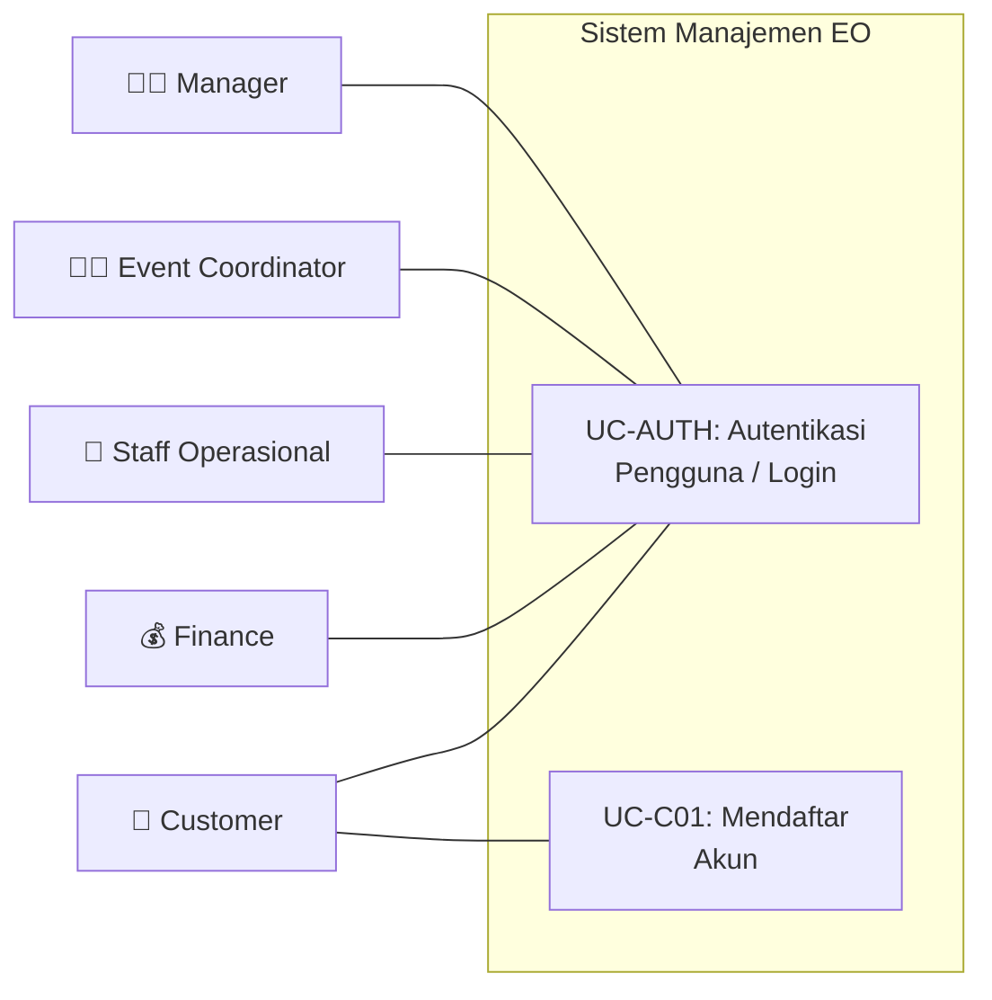
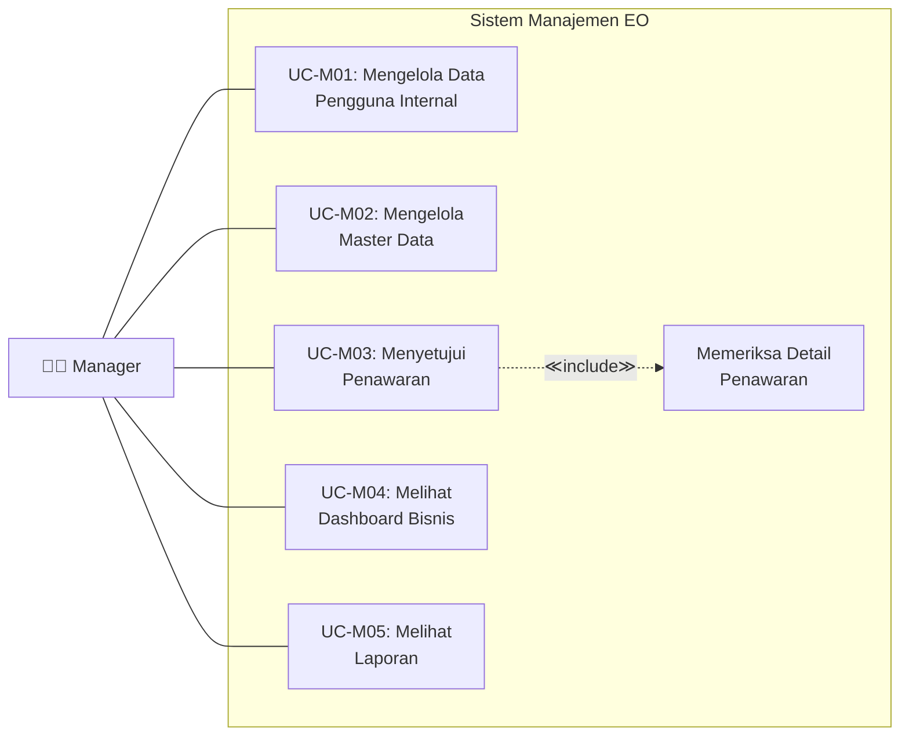
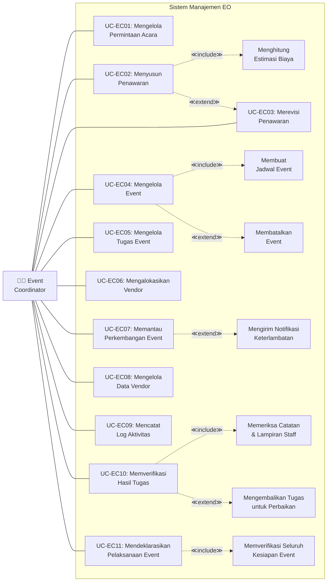
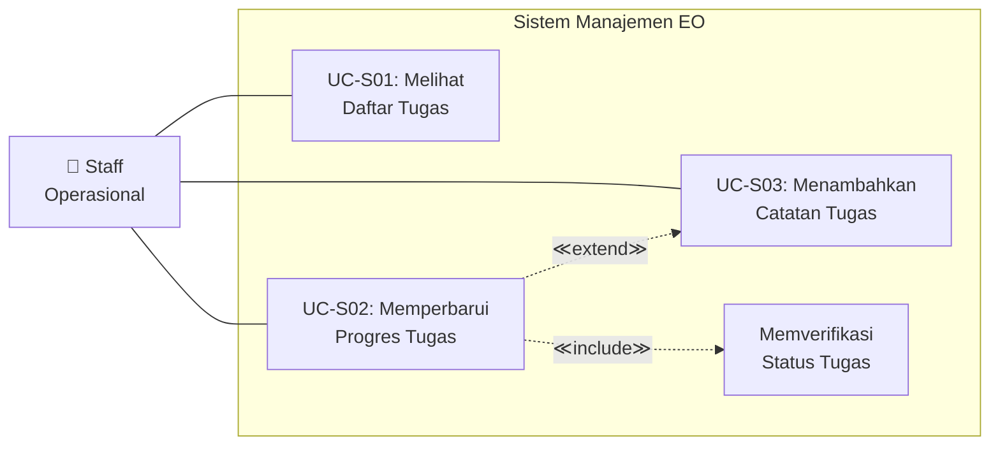
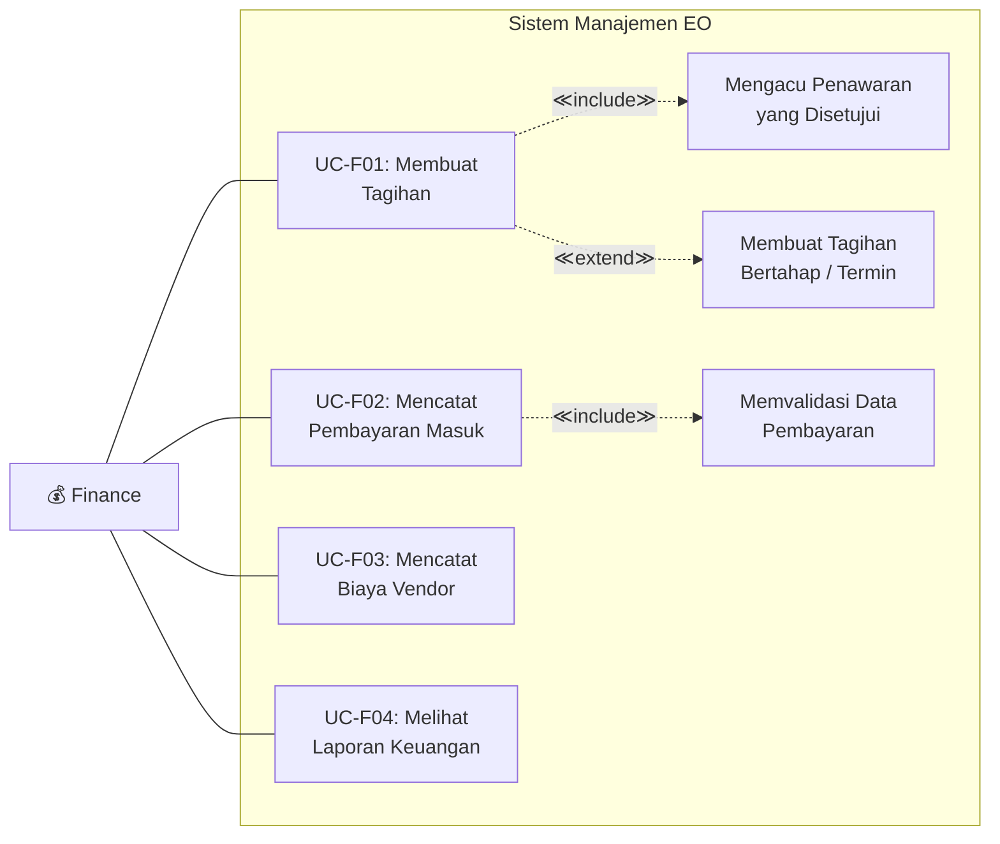
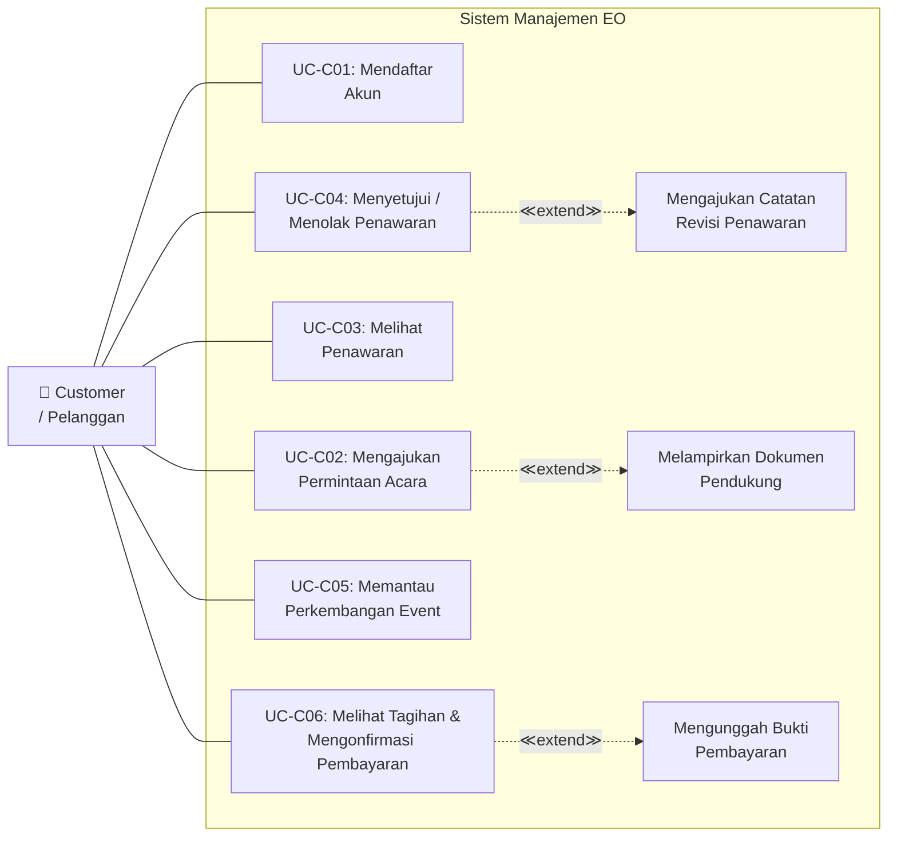
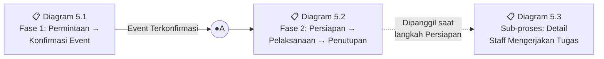
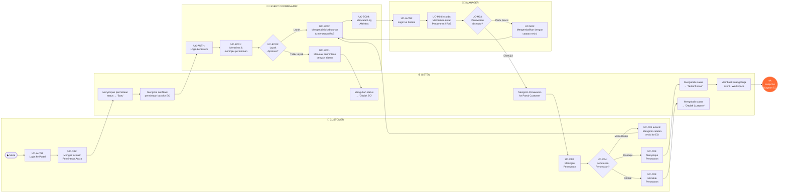
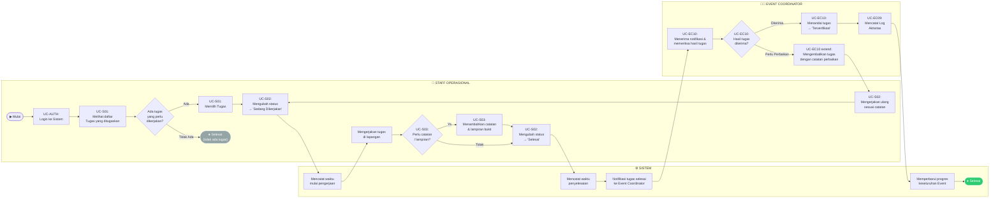

# Use Case & Activity Diagram — Sistem Manajemen Event Organizer
## Versi Final (Konsisten)

> [!IMPORTANT]
> Dokumen ini adalah versi **final** yang telah menerapkan seluruh perbaikan dari hasil analisis konsistensi (Pertanyaan 4). Seluruh aktivitas pada Activity Diagram memiliki representasi di Use Case Diagram, dan sebaliknya. **0 inkonsistensi.**

---

## 1. Identifikasi Aktor

| No | Aktor | Tipe | Deskripsi |
|----|-------|------|-----------|
| 1 | Manager | Internal | Pemilik/pimpinan EO. Bertanggung jawab atas persetujuan penawaran, monitoring bisnis, pengelolaan pengguna internal, dan master data. |
| 2 | Event Coordinator | Internal | Pengelola proyek event. Menangani permintaan acara, penyusunan penawaran, perencanaan event, alokasi vendor, verifikasi tugas, dan koordinasi tim. |
| 3 | Staff Operasional | Internal | Pelaksana tugas lapangan. Mengerjakan tugas yang diberikan dan melaporkan perkembangan. |
| 4 | Finance | Internal | Pengelola keuangan. Menangani tagihan, pencatatan pembayaran, pencatatan biaya vendor, dan laporan keuangan. |
| 5 | Customer | Eksternal | Pelanggan yang mengajukan permintaan acara, menyetujui penawaran, memantau perkembangan, dan mengonfirmasi pembayaran. |

---

## 2. Daftar Use Case per Aktor

### 2.0 Semua Aktor (Universal)

| Kode | Use Case | Deskripsi |
|------|----------|-----------|
| UC-AUTH | Autentikasi Pengguna (Login) | Semua aktor melakukan proses login sebelum mengakses fitur sistem sesuai hak aksesnya masing-masing. |

### 2.1 Manager

| Kode | Use Case | Deskripsi |
|------|----------|-----------|
| UC-M01 | Mengelola Data Pengguna Internal | Menambah, mengubah, dan menghapus akun pengguna internal (Event Coordinator, Staff, Finance) |
| UC-M02 | Mengelola Master Data | Menambah, mengubah, dan menghapus data referensi (kategori event, kategori vendor, dll.) |
| UC-M03 | Menyetujui Penawaran | Memeriksa dan memberikan persetujuan atau penolakan terhadap penawaran yang disusun Event Coordinator |
| UC-M04 | Melihat Dashboard Bisnis | Melihat ringkasan jumlah event, pendapatan, dan status event yang sedang berjalan |
| UC-M05 | Melihat Laporan | Melihat laporan keuangan, histori event, dan evaluasi performa vendor |

### 2.2 Event Coordinator

| Kode | Use Case | Deskripsi |
|------|----------|-----------|
| UC-EC01 | Mengelola Permintaan Acara | Menerima, meninjau, dan merespons permintaan acara yang masuk dari pelanggan |
| UC-EC02 | Menyusun Penawaran | Menyusun Rencana Anggaran Biaya (RAB) berdasarkan permintaan acara pelanggan |
| UC-EC03 | Merevisi Penawaran | Membuat versi revisi penawaran apabila ada perubahan permintaan dari pelanggan atau catatan dari Manager |
| UC-EC04 | Mengelola Event | Membuat data event baru setelah penawaran disetujui, mengatur jadwal dan detail pelaksanaan |
| UC-EC05 | Mengelola Tugas Event | Membuat checklist tugas persiapan dan menugaskan ke Staff Operasional |
| UC-EC06 | Mengalokasikan Vendor | Memilih dan menugaskan vendor ke event beserta pencatatan estimasi biaya vendor |
| UC-EC07 | Memantau Perkembangan Event | Melihat status keseluruhan persiapan event berdasarkan progres tugas dan kesiapan vendor |
| UC-EC08 | Mengelola Data Vendor | Menambah, mengubah, dan menghapus data vendor (nama, kategori layanan, kontak) |
| UC-EC09 | Mencatat Log Aktivitas | Mencatat notulensi rapat, hasil komunikasi, dan catatan penting terkait event pada titik-titik kritis proses |
| UC-EC10 | Memverifikasi Hasil Tugas | Memeriksa dan memvalidasi hasil tugas yang dilaporkan selesai oleh Staff Operasional, kemudian menyetujui atau mengembalikan untuk perbaikan |
| UC-EC11 | Mendeklarasikan Pelaksanaan Event | Menandai bahwa seluruh persiapan telah selesai dan event resmi memasuki tahap pelaksanaan, memicu proses pembayaran dan penutupan |

### 2.3 Staff Operasional

| Kode | Use Case | Deskripsi |
|------|----------|-----------|
| UC-S01 | Melihat Daftar Tugas | Melihat seluruh tugas yang ditugaskan kepadanya beserta tenggat waktu |
| UC-S02 | Memperbarui Progres Tugas | Mengubah status tugas (Belum Dikerjakan → Sedang Dikerjakan → Selesai) |
| UC-S03 | Menambahkan Catatan Tugas | Memberikan catatan atau lampiran pada tugas sebagai bukti pengerjaan |

### 2.4 Finance

| Kode | Use Case | Deskripsi |
|------|----------|-----------|
| UC-F01 | Membuat Tagihan | Membuat tagihan pembayaran untuk pelanggan berdasarkan penawaran yang telah disetujui |
| UC-F02 | Mencatat Pembayaran Masuk | Mencatat dan memvalidasi pembayaran yang diterima dari pelanggan (DP, termin, pelunasan) |
| UC-F03 | Mencatat Biaya Vendor | Mencatat pengeluaran ke vendor (Harga Pokok Penjualan) per event |
| UC-F04 | Melihat Laporan Keuangan | Melihat rekap pemasukan, pengeluaran, dan laba/rugi per event maupun keseluruhan |

### 2.5 Customer (Pelanggan)

| Kode | Use Case | Deskripsi |
|------|----------|-----------|
| UC-C01 | Mendaftar Akun | Mendaftar akun baru pada portal pelanggan (registrasi) |
| UC-C02 | Mengajukan Permintaan Acara | Mengisi formulir permintaan acara baru (jenis acara, tanggal, lokasi, konsep, estimasi peserta) |
| UC-C03 | Melihat Penawaran | Melihat detail estimasi biaya yang dikirimkan oleh pihak EO |
| UC-C04 | Menyetujui / Menolak Penawaran | Memberikan persetujuan atau penolakan terhadap penawaran (disertai catatan jika ada) |
| UC-C05 | Memantau Perkembangan Event | Melihat status dan progres persiapan acara secara langsung |
| UC-C06 | Melihat Tagihan & Mengonfirmasi Pembayaran | Melihat daftar tagihan, mengunggah bukti pembayaran, dan mengonfirmasi bahwa pembayaran telah dilakukan |

---

## 3. Relasi Include dan Extend

### 3.1 Penjelasan Singkat

- **<<include\>>**: Relasi **wajib**. Use case induk **selalu** memanggil use case yang di-include.
- **<<extend\>>**: Relasi **opsional/kondisional**. Hanya terjadi pada kondisi tertentu.

### 3.2 Tabel Relasi Include

| Use Case Induk | Relasi | Use Case yang Dipanggil | Penjelasan |
|----------------|--------|-------------------------|------------|
| UC-EC02: Menyusun Penawaran | <<include\>> | Menghitung Estimasi Biaya | Setiap penyusunan penawaran **wajib** menyertakan perhitungan rincian biaya (RAB) |
| UC-M03: Menyetujui Penawaran | <<include\>> | Memeriksa Detail Penawaran | Manager **wajib** memeriksa rincian biaya dan konsep sebelum memberikan keputusan |
| UC-F01: Membuat Tagihan | <<include\>> | Mengacu Penawaran yang Disetujui | Pembuatan tagihan **wajib** berdasarkan penawaran yang sudah berstatus disetujui |
| UC-F02: Mencatat Pembayaran Masuk | <<include\>> | Memvalidasi Data Pembayaran | Setiap pencatatan pembayaran **wajib** melalui proses validasi (nominal, bukti transfer, dll.) |
| UC-EC04: Mengelola Event | <<include\>> | Membuat Jadwal Event | Pembuatan event **wajib** disertai penentuan tanggal pelaksanaan dan timeline persiapan |
| UC-S02: Memperbarui Progres Tugas | <<include\>> | Memverifikasi Status Tugas | Sistem **wajib** memverifikasi transisi status tugas yang valid |
| UC-EC10: Memverifikasi Hasil Tugas | <<include\>> | Memeriksa Catatan & Lampiran Staff | EC **wajib** memeriksa bukti pengerjaan sebelum menandai tugas terverifikasi |
| UC-EC11: Mendeklarasikan Pelaksanaan Event | <<include\>> | Memverifikasi Seluruh Kesiapan | EC **wajib** memastikan semua tugas terverifikasi dan vendor siap sebelum deklarasi |

### 3.3 Tabel Relasi Extend

| Use Case Induk | Relasi | Use Case Tambahan | Kondisi Pemicu |
|----------------|--------|-------------------|----------------|
| UC-EC02: Menyusun Penawaran | <<extend\>> | UC-EC03: Merevisi Penawaran | Terjadi **jika** pelanggan meminta perubahan atau Manager meminta revisi |
| UC-C04: Menyetujui / Menolak Penawaran | <<extend\>> | Mengajukan Catatan Revisi | Terjadi **jika** pelanggan tidak langsung menyetujui dan memberikan catatan perubahan |
| UC-S02: Memperbarui Progres Tugas | <<extend\>> | UC-S03: Menambahkan Catatan Tugas | Terjadi **jika** Staff perlu menyertakan bukti foto, catatan kendala, atau lampiran |
| UC-F01: Membuat Tagihan | <<extend\>> | Membuat Tagihan Bertahap (Termin) | Terjadi **jika** skema pembayaran menggunakan sistem termin/bertahap |
| UC-EC04: Mengelola Event | <<extend\>> | Membatalkan Event | Terjadi **jika** pelanggan membatalkan acara setelah event sudah dibuat |
| UC-EC07: Memantau Perkembangan Event | <<extend\>> | Mengirim Notifikasi Keterlambatan | Terjadi **jika** ada tugas yang melewati tenggat waktu |
| UC-C02: Mengajukan Permintaan Acara | <<extend\>> | Melampirkan Dokumen Pendukung | Terjadi **jika** pelanggan ingin menyertakan referensi gambar, denah, atau dokumen |
| UC-C06: Melihat Tagihan & Mengonfirmasi Pembayaran | <<extend\>> | Mengunggah Bukti Pembayaran | Terjadi **jika** pelanggan melakukan pembayaran dan perlu mengunggah bukti transfer |
| UC-EC10: Memverifikasi Hasil Tugas | <<extend\>> | Mengembalikan Tugas untuk Perbaikan | Terjadi **jika** hasil tugas tidak memenuhi standar dan perlu dikerjakan ulang |

---

## 4. Use Case Diagram

### 4.0 Diagram Use Case — Autentikasi (Semua Aktor)

### 4.1 Diagram Use Case — Manager

### 4.2 Diagram Use Case — Event Coordinator

### 4.3 Diagram Use Case — Staff Operasional

### 4.4 Diagram Use Case — Finance

### 4.5 Diagram Use Case — Customer (Pelanggan)

---

## 5. Activity Diagram (Format Swimlane)

> [!NOTE]
> Seluruh aktivitas pada diagram di bawah telah dipetakan ke Use Case yang bersangkutan (ditandai dengan kode UC pada label node). Diagram dipecah menjadi 2 fase besar yang dihubungkan melalui **Titik Sambung ●A**, plus 1 sub-proses detail. **UC-AUTH** (Login) merupakan prasyarat untuk semua diagram dan ditampilkan secara eksplisit pada langkah awal.

### Peta Koneksi Antar Diagram

---

### 5.1 Fase 1: Permintaan Acara → Konfirmasi Event

Swimlane: **Customer** · **Event Coordinator** · **Manager** · **Sistem**
Berlanjut ke → **Diagram 5.2** melalui titik sambung **●A**

---

### 5.2 Fase 2: Persiapan → Pelaksanaan → Pembayaran → Penutupan

Swimlane: **Event Coordinator** · **Staff Operasional** · **Finance** · **Customer** · **Sistem**
Dimulai dari titik sambung **●A** (lanjutan Diagram 5.1)

#### Proses Paralel (Fork/Join) pada Fase 2

| | Fork (Percabangan Paralel) | Jalur A | Jalur B | Join (Penggabungan) |
|---|---|---|---|---|
| **Fork 1** | Setelah EC membuat daftar tugas persiapan | Menugaskan & eksekusi Tugas oleh Staff | Mengalokasikan Vendor & pencatatan biaya | Kedua jalur selesai → **"Memverifikasi kesiapan"** |
| **Fork 2** | Setelah EC mendeklarasikan pelaksanaan event | EC mengubah status Event → 'Selesai' + mencatat Log Aktivitas | Finance memulai siklus Tagihan → Pembayaran → HPP → Laba/Rugi | Kedua jalur selesai → **"Status Event → Closed"** |

```mermaid
flowchart LR

    PA(("●A\nDari\nDiagram 5.1")) --> EC_1

    subgraph EC2["🧑‍💻 EVENT COORDINATOR"]
        direction LR
        EC_1["UC-EC04:\nMembuat perencanaan\nEvent & timeline"]
        EC_2["UC-EC05:\nMembuat daftar\nTugas persiapan"]
        EC_3["UC-EC05:\nMenugaskan Tugas\nke Staff"]
        EC_4["UC-EC06:\nMengalokasikan\nVendor"]
        EC_5["UC-EC07:\nMemantau &\nmemverifikasi kesiapan"]
        EC_6{"UC-EC11:\nEvent siap\ndilaksanakan?"}
        EC_7["UC-EC07:\nMeninjau ulang\ntugas tertunda"]
        EC_8["UC-EC11:\nMendeklarasikan\nPelaksanaan Event"]
        EC_9["UC-EC04:\nMengubah status\nEvent → 'Selesai'"]
        EC_LOG["UC-EC09:\nMencatat Log\nAktivitas"]
    end

    subgraph FORKJOIN["⚡ FORK / JOIN"]
        direction LR
        FORK1["══ FORK 1 ══"]
        JOIN1["══ JOIN 1 ══"]
        FORK2["══ FORK 2 ══"]
        JOIN2["══ JOIN 2 ══"]
    end

    subgraph STF["👷 STAFF OPERASIONAL"]
        direction LR
        ST_1["UC-S01:\nMenerima &\nmelihat Tugas"]
        ST_2["Sub-proses 5.3:\nMengerjakan Tugas\n→ update progres"]
        ST_3{"Semua tugas\nterverifikasi?"}
    end

    subgraph SIS2["⚙️ SISTEM"]
        direction LR
        SY_1["Notifikasi Tugas\nbaru ke Staff"]
        SY_2["Mencatat alokasi\n& biaya vendor"]
        SY_3["Notifikasi tugas\nterverifikasi ke EC"]
        SY_4["Mengirim Tagihan\nke Portal Customer"]
        SY_5["Memperbarui status\npembayaran"]
        SY_6{"Sudah\nlunas?"}
        SY_7["Status pembayaran\n→ 'Lunas'"]
        SY_8["Menghitung Laba/Rugi\nper Event"]
        SY_9["Status Event\n→ 'Closed'"]
        FINISH(["⏹ Selesai"])
    end

    subgraph FIN["💰 FINANCE"]
        direction LR
        F_0["UC-AUTH:\nLogin ke Sistem"]
        F_1["UC-F01:\nMembuat Tagihan\n(DP / Termin / Penuh)"]
        F_2["UC-F02:\nMencatat &\nmemvalidasi pembayaran"]
        F_3["UC-F01 extend:\nMembuat Tagihan\nberikutnya"]
        F_4["UC-F03:\nMencatat biaya\nVendor sebagai HPP"]
    end

    subgraph CUS2["👤 CUSTOMER"]
        direction LR
        CU_1["UC-C06:\nMelihat Tagihan\ndi Portal"]
        CU_2["UC-C06:\nMengonfirmasi &\nmengunggah bukti bayar"]
    end

    %% Alur awal
    EC_1 --> EC_2

    %% ══ FORK 1: Tugas & Vendor paralel ══
    EC_2 --> FORK1
    FORK1 -->|"Jalur A"| EC_3 --> SY_1 --> ST_1 --> ST_2
    FORK1 -->|"Jalur B"| EC_4 --> SY_2
    ST_2 --> ST_3
    ST_3 -->|"Belum"| ST_2
    ST_3 -->|"Sudah"| SY_3

    %% ══ JOIN 1 ══
    SY_3 --> JOIN1
    SY_2 --> JOIN1
    JOIN1 --> EC_5

    EC_5 --> EC_6
    EC_6 -->|"Belum Siap"| EC_7 --> ST_2
    EC_6 -->|"Siap"| EC_8

    %% ══ FORK 2: Status & Pembayaran paralel ══
    EC_8 --> FORK2
    FORK2 -->|"Jalur A"| EC_9 --> EC_LOG
    FORK2 -->|"Jalur B"| F_0 --> F_1 --> SY_4 --> CU_1 --> CU_2 --> F_2 --> SY_5 --> SY_6
    SY_6 -->|"Belum"| F_3 --> SY_4
    SY_6 -->|"Lunas"| SY_7 --> F_4 --> SY_8

    %% ══ JOIN 2 ══
    EC_LOG --> JOIN2
    SY_8 --> JOIN2
    JOIN2 --> SY_9 --> FINISH

    style PA fill:#ff6b35,stroke:#fff,color:#fff
    style FINISH fill:#2ecc71,stroke:#fff,color:#fff
    style FORK1 fill:#333,stroke:#333,color:#fff
    style JOIN1 fill:#333,stroke:#333,color:#fff
    style FORK2 fill:#333,stroke:#333,color:#fff
    style JOIN2 fill:#333,stroke:#333,color:#fff
```

---

### 5.3 Sub-proses: Detail Staff Operasional Mengerjakan Tugas

Swimlane: **Staff Operasional** · **Event Coordinator** · **Sistem**
Sub-proses ini dipanggil pada **Diagram 5.2** setiap kali Staff mengerjakan tugas.

---

## 6. Checklist Konsistensi

Berikut verifikasi bahwa **seluruh Use Case memiliki representasi di Activity Diagram** dan sebaliknya:

| Use Case | Muncul di Activity Diagram | Status |
|----------|---------------------------|--------|
| UC-AUTH: Autentikasi Pengguna | Diagram 5.1 (Customer, EC, Manager), 5.2 (Finance), 5.3 (Staff) | ✅ |
| UC-C01: Mendaftar Akun | Pra-kondisi untuk UC-AUTH (di luar alur operasional) | ✅ |
| UC-C02: Mengajukan Permintaan Acara | Diagram 5.1 — Customer | ✅ |
| UC-C03: Melihat Penawaran | Diagram 5.1 — Customer | ✅ |
| UC-C04: Menyetujui / Menolak Penawaran | Diagram 5.1 — Customer | ✅ |
| UC-C05: Memantau Perkembangan Event | Tersedia di Portal (fitur pasif, tidak mengubah alur) | ✅ |
| UC-C06: Melihat Tagihan & Mengonfirmasi Pembayaran | Diagram 5.2 — Customer | ✅ |
| UC-M01: Mengelola Data Pengguna Internal | Pra-kondisi (setup awal, tidak masuk alur operasional) | ✅ |
| UC-M02: Mengelola Master Data | Pra-kondisi (setup awal, tidak masuk alur operasional) | ✅ |
| UC-M03: Menyetujui Penawaran | Diagram 5.1 — Manager | ✅ |
| UC-M04: Melihat Dashboard Bisnis | Fitur monitoring pasif (tidak mengubah alur) | ✅ |
| UC-M05: Melihat Laporan | Fitur monitoring pasif (tidak mengubah alur) | ✅ |
| UC-EC01: Mengelola Permintaan Acara | Diagram 5.1 — Event Coordinator | ✅ |
| UC-EC02: Menyusun Penawaran | Diagram 5.1 — Event Coordinator | ✅ |
| UC-EC03: Merevisi Penawaran | Diagram 5.1 — loop revisi (<<extend\>>) | ✅ |
| UC-EC04: Mengelola Event | Diagram 5.2 — Event Coordinator (perencanaan & penutupan) | ✅ |
| UC-EC05: Mengelola Tugas Event | Diagram 5.2 — Event Coordinator (buat & assign tugas) | ✅ |
| UC-EC06: Mengalokasikan Vendor | Diagram 5.2 — Event Coordinator (Fork 1 Jalur B) | ✅ |
| UC-EC07: Memantau Perkembangan Event | Diagram 5.2 — Event Coordinator (verifikasi kesiapan) | ✅ |
| UC-EC08: Mengelola Data Vendor | Pra-kondisi (master data, setup sebelum alur operasional) | ✅ |
| UC-EC09: Mencatat Log Aktivitas | Diagram 5.1 (setelah menyusun RAB), 5.2 (setelah event selesai), 5.3 (setelah verifikasi tugas) | ✅ |
| UC-EC10: Memverifikasi Hasil Tugas | Diagram 5.3 — Event Coordinator | ✅ |
| UC-EC11: Mendeklarasikan Pelaksanaan Event | Diagram 5.2 — Event Coordinator (decision + deklarasi) | ✅ |
| UC-S01: Melihat Daftar Tugas | Diagram 5.2 & 5.3 — Staff Operasional | ✅ |
| UC-S02: Memperbarui Progres Tugas | Diagram 5.3 — Staff Operasional | ✅ |
| UC-S03: Menambahkan Catatan Tugas | Diagram 5.3 — Staff Operasional (<<extend\>>) | ✅ |
| UC-F01: Membuat Tagihan | Diagram 5.2 — Finance | ✅ |
| UC-F02: Mencatat Pembayaran Masuk | Diagram 5.2 — Finance | ✅ |
| UC-F03: Mencatat Biaya Vendor | Diagram 5.2 — Finance (setelah lunas) | ✅ |
| UC-F04: Melihat Laporan Keuangan | Fitur monitoring pasif (tidak mengubah alur) | ✅ |
